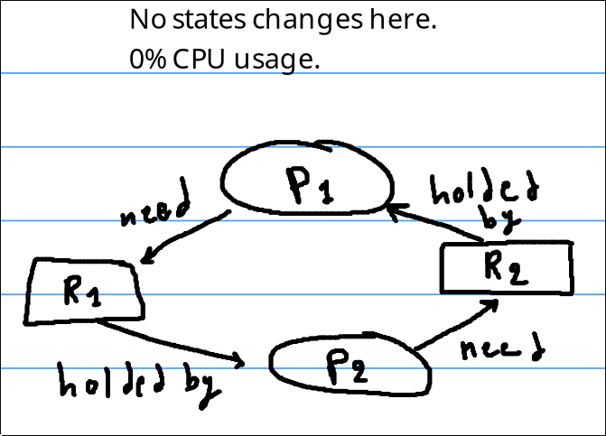

Multithreading and concurrency are very tough to master, so we must understand the main concept and problems related to them. 

Some of these concept maybe unrelated directly to Codexion, but they are good to know.


## **1) Dead-lock** 

* When two or more processes or threads stuck by needing or depending on resources that the other hold `hold state (No state changes)` -> freeze.
* This problem was the result of trying to solve other problems like **race conditions**.
* CPU usage is 0 here .



### Main conditions for a dead lock to happen (MHNC) 

1) **Mutual exclusion (Mutex)**: Any resources must be held by exactly one process at a time, this can avoid **race condition**.

2) **Hold and wait**: A process must hold a resource while waiting for other resources held by other processes.

3) **No-preemption**: A concept says that a process can't take a resource from another process while it didn't finish it's task.

4) **Circular wait**: Set of process waiting for resources that are being held by the next one.


## **2) Live-lock**

* Two or more **concurrent processes continuously change their states** in response to the actions of the other processes, preventing any of them from making actual progress.
* Same as dead lock, but this time the states of the process changes, and now it consuming CPU usage unlike **dead lock**.
* It happens in the same scenario as above, but this time from improperly implemented **deadlock-avoidance algorithms**.

 
*Problem*: If we have P1 that holds R1 and it needs R2, and P2 holds R2 and it need R1. In this case we have obvious **dead lock**. The solution here maybe would be to make them both in **sleep** state so when they are in **running** state, both of them could take the new released resources from the other one. The problem is that both of them could do that in a perfect, bad sync time, so now the sleep state of both of them could be the same milliseconds, and when they are in running state, they need to achieve the **hold and wait** condition (explained above). 

Solution: We need only to change one main line in the code, which is to randomize the sleep time for each of the process.

```
p1.sleep = random = 2 millisecond
p2.sleep = random = 4 millisecon
```


## **Race condition**

